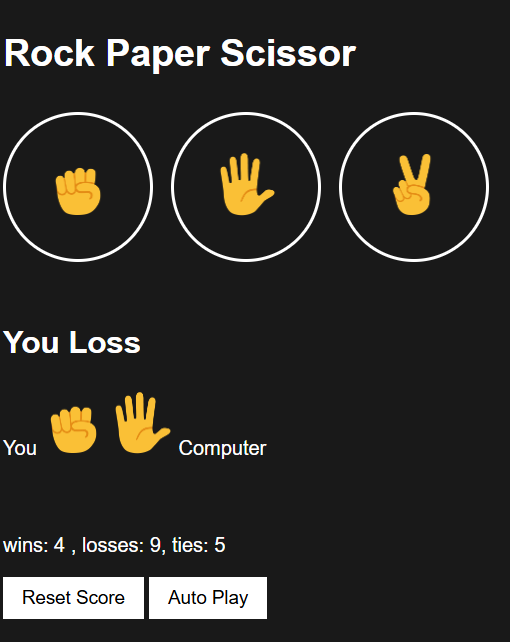
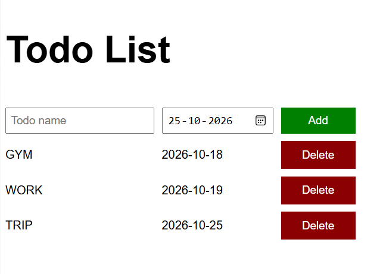

# JavaScript Projects

A collection of beginner-friendly web development projects built using HTML, CSS, and JavaScript.

## Projects

### 1. Rock Paper Scissors
A simple interactive game where users play Rock Paper Scissors against the computer.

**Technologies:** HTML, CSS, JavaScript

### 2. To-Do List
A task management application that allows users to organize their daily tasks.

**Technologies:** HTML, CSS, JavaScript

## Screenshots

### Rock Paper Scissors

### To-Do List

## How to Run

1. Clone or download this repository.
2. Open the desired project folder.
3. Open its `index.html` file in your browser.

## Technologies Used
- HTML5
- CSS3
- JavaScript